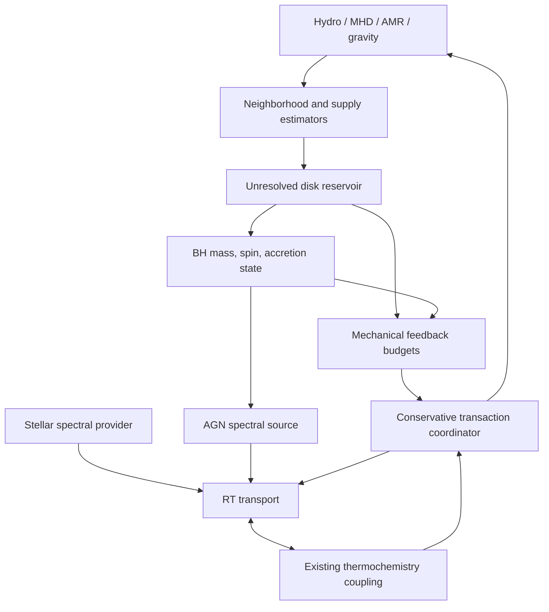

# CHUÍ — Radiation, Black Holes and AGN: Master Design

**Version:** 0.1 · **Date:** 2026-11-26 · **Status:** agreed direction; proposed normative specification, not implemented or certified  
**Reference campaign:** `CHUI-RT-BH-AGN-REF-v1`  
**Target:** powerful desktops and small/medium HPC first; full distributed supercomputer execution supported by design.

## 1. Mission and boundaries

CHUÍ shall pursue maximum defensible physical fidelity, numerical accuracy and predictive capability per computational resource, with a scientifically auditable research framework. Competitive parity comes before claims of innovation. Parity means comparable validated scientific capabilities in matched regimes, not feature counts or copying a competing simulation's calibration. No hardware tier shall impose an artificial upper limit on physical capability; the user chooses the science model, resolution and resources. Scientific approximations must never change silently under memory pressure.

This campaign covers time-dependent multigroup RT, radiation–matter coupling, BH formation/dynamics/accretion/mergers/spin, AGN thermal/mechanical/radiative/magnetic feedback, and their AMR, MPI, scheduler, restart and resource interfaces. Cooling, chemistry, ISM, stellar evolution, enrichment and dust microphysics belong to the existing baryonic campaign; this campaign consumes their authoritative rates, state and spectra. It does not create a duplicate chemistry or cooling implementation. Magnetic evolution belongs to MHD. GRRMHD, SRMHD propagation, cosmic rays, adaptive angular/spectral closures and radial disk PDEs remain separate research projects.

MUST/SHALL are acceptance requirements; SHOULD requires written justification for deviation; MAY identifies an option. A feature is not certified by code presence. Distinguish specified, implemented, integrated, verified, calibrated, validated, and production-qualified statuses.

## 2. Source baseline and precedence

Target archive: `Chui-dev-main(11).zip`, root `Chui-dev-main/`. This is a targeted static inspection, not a live branch audit or build. Existing interfaces observed:

| Source | Relevant contract / gap |
|---|---|
| `include/cosmosim/physics/black_hole_agn.hpp`, `docs/black_hole_agn.md` | `BlackHoleAgnModel`, `BlackHoleAgnAccretionView`, rate calculator, seed candidates, host-cell accretion, thermal feedback, Newtonian mass ledger; preserve reference behavior |
| `src/workflows/source_runtime.cpp:1127–1128` | production seeding fails closed pending an authoritative halo/candidate provider |
| `include/cosmosim/physics/thermochemistry_operator.hpp` | staged row and result, unit bridge, existing thermochemical operator; extend with coupled source interface rather than duplicate state |
| `include/cosmosim/core/time_integration.hpp` | `kHydroUpdate`, `kSourceTerms`, stage contracts; do not add a global stage without ADR |
| `include/cosmosim/core/simulation_state.hpp` | `BlackHoleParticleSidecar`, gas-cell identity and migration fields; version optional state and use stable IDs |
| `docs/architecture/chui_mhd_architecture_specification_v01.md` | staggered CT and Lorentz–Heaviside magnetic convention; radiation–MHD coupling is outside that reference scope and requires this extension |
| `docs/architecture/adr_param_txt_configuration_format.md` | `.param.txt` is authoritative, not YAML |
| `docs/output_schema.md` | native non-MHD snapshot v6 / restart v25 documented, MHD snapshot v7 extension also documented; inspect active schema constants before assigning any next version |

No on-the-fly RT backend was identified in the targeted archive inspection. `radiation_background` is not a transport solver. Existing BH tests and benchmarks are not proof of scientific validation. Live `.cpp`/`.hpp` and `cosmosim::` conventions take precedence over older example extensions/namespaces; lower_snake file stems and explicit unit/frame names remain mandatory. Existing configuration keys remain compatible. Exact new key spellings, active schema numbers and registration hooks require implementation preflight against the chosen commit.

Project authority: revised master design (2026-03-11), memory architecture v0.1 (2026-08-23), file and variable naming v1.0, repository ADRs, existing MHD and thermochemistry contracts. This design extends, not silently supersedes, those contracts. Resolve conflicts with explicit amendments.

## 3. Frozen direction and milestones

P0 is the essential foundation. P1 completes the proposed competitive reference capability; P1 algorithms must have explicit model qualifications before production. Research stays opt-in, separately versioned and never a dependency of reference runs.

| Capability | P0 | P1 | Research |
|---|---|---|---|
| RT | finite-volume multigroup M1; HLL; realizability; two-stage IMEX; static/dynamic diffusion; full and reduced c; cosmological redshift; AMR | adaptive direct-source rays; VET; hard spectra, dust IR transport through existing microphysics interface; Monte Carlo reference/postprocessing | discrete ordinates, adaptive angular/frequency representations, global implicit transport |
| BH formation/dynamics | halo seeding, physical orbital integration, unresolved friction, bound-pair mergers | qualified local seed models, binary delay, recoil/remnant fits | resolved nuclear dynamics, PN binaries |
| Supply | neighborhood hot Bondi and cold gravitational torque; angular-suppressed comparator | resolved inward flux control surface | resolution-adaptive closure |
| Inner accretion | instantaneous legacy comparator; scalar disk reservoir; Eddington-limited reference | vector disk angular momentum, Kerr spin, thick/thin/slim states, optional super-Eddington | radial viscous PDE, GRMHD-informed calibration beyond baseline |
| Feedback | continuous/reservoir thermal; energy-consistent kicks; mass-loaded winds; bipolar volumetric jets; spectra; AMR refinement | resolved nozzle, CT-compatible magnetic injection, BZ-informed spin extraction | specialized wind carriers, relativistic propagation, CR coupling |
| Execution | CPU/OpenMP and spatial MPI, hard budgets, exact restart contract | GPU kernels, distributed VET/rays, performance qualification at scale | angular/spectral decomposition, hybrid closures |

P0/P1 is a dependency classification, not permission to label partially connected code production-ready. GPU acceleration is a competitive release requirement but CPU remains a scientifically equivalent reference. Physical local seeding requires stellar/metal/radiation inputs; design interface P0, qualify specific models in P1. Do not invent missing data or calibration values.

## 4. Architecture and authority

- `SimulationState` owns persistent scientific truth. Hydro/MHD owns resolved mass, momentum, energy, metals and magnetic face flux. RT owns radiation moments or another explicitly versioned transport state. Chemistry owns species and chemical energy. BH owns horizon mass/spin and its disk/pending budgets. The scheduler owns time; AMR owns topology; governor owns admission.
- No independent heating by both RT and chemistry. One absorption event creates the same matter/radiation debit and credit, with chemical binding and thermal partition provided by the existing thermochemistry authority. Background radiation and resolved source fields are disjoint contributions with explicit spectral coverage and overlap policy.
- Store no duplicate gas state to make another module convenient. Views are non-owning; scratch is bounded. Sparse BH state follows particles by stable ID, never persistent row index alone. Radiation belongs to mesh geometry, not particle sidecars.

## 5. Physical and transaction contracts

Use physical proper rates and peculiar velocities at the evaluation scale factor. Position, area, volume, density, time, momentum, energy and radiation moments have declared transforms. Source transactions use integrated physical/code quantities, then convert once into canonical solver lanes. `rho_phys=rho_comov/a^3`, `dx_phys=a dx_comov`, `dt_phys=da/(a H(a))` for an expanding model. Never infer time conversion from step index. Isolated mode uses a=1 and H=0. MHD uses repository's normalized magnetic field, not an unconverted Gaussian field.

A transaction ID comprises stable source ID, scheduler interval, channel and deterministic sequence. The plan declares donor/recipient IDs, owner ranks, topology epoch, source frame, integrated mass/species/momentum/energy/angular momentum, reserved scratch and intended time. A prepare phase checks availability, floors, realizability, topology and budget; only then commit exactly once. Failed preparation changes no canonical state. A distributed commit needs unanimous authorization of participants and no rank-independent partial mutation; fatal communication failure aborts to the last committed checkpoint. No replay of an already applied event. Conflicting withdrawals are resolved deterministically or via jointly limited allocations. Diagnostics use actual transfers, not requested amounts.

Two BH accounting models are intentionally distinct: legacy Newtonian rest-mass transfer and advanced relativistic mass-defect accounting (BH companion §6). Conservation tests name the invariant appropriate to the chosen model. Physical rest-mass-energy, radiation approximation invariants, escaping radiation, unresolved reservoirs, boundary flux, cosmological redshift and gravity work are separate ledger terms. Do not claim constant total Newtonian energy in expanding space.

## 6. Scheduler and coupling contract

Keep existing global integration stages. Within a legal synchronization interval, establish topology and active sets, evaluate gas/BH environments at the declared time, reserve/commit donor transfer and disk evolution, form time-integrated source budgets, then couple transport and matter consistently with hydro/MHD. Candidate scheduling: symmetric source composition around resolved evolution when the existing scheduler permits; RT subcycles with time-aware emission; a single thermochemical source authority per interval. Exact splitting order must be bound to actual `StageContract` semantics in preflight; do not call both the legacy BH callback and new coordinator for the same interval. No claim of second-order global coupling until convergence demonstrates it.

For inactive targets: synchronize/wake before strong deposition or store a conservative time-tagged pending transaction whose physical latency is qualified; cannot mutate gas at a future timestamp. For AMR subcycling: reflux before dependent sync-stage mutations, apply source only once per leaf physical interval, and rebuild invalidated caches/force state via existing mutation hooks. Use level-synchronous stepping until distributed time-interpolated ghosts and flux registers are verified. Radiation timestep is separate from gas CFL; stiff local coupling cannot remove transport CFL. See RT companion.

## 7. Configuration, I/O, diagnostics

Use typed config normalized to `.param.txt`; reject unknown or incompatible modes, missing tables and unqualified enabled combinations. Proposed keys (not existing parser promises): `physics.rt_enabled`, `physics.rt_transport`, `physics.rt_integrator`, `physics.rt_spectral_profile`, `physics.rt_c_fraction`, `physics.bh_supply_model`, `physics.bh_disk_model`, `physics.bh_mass_ledger`, `physics.agn_feedback_model`. Preserve `physics.enable_black_hole_agn` and old BH keys; map explicitly through compatibility adapter. Never guess units. Every table/closure records source, hash, validity range and calibration ID; restart must match physics configuration unless a validated migration explicitly changes it.

Native restart includes all authoritative BH/disk/radiation state, source interval cursors, pending event IDs, RNG counters and AMR flux/history when checkpointing mid-interval is supported. Initially allow checkpoints only at fully synchronized commit boundaries. Science snapshots use native versioned mesh and BH fields plus explicit compatibility exports; preserve canonical GADGET names in export. Record luminosity, channel budgets, BH masses/spins, Eddington convention, disk state, merger/seed event logs, photon rates, escaping fluxes, RT subcycles, implicit residuals, floor/fallback counts, resolution inadequacy and memory high-water. Never treat a science snapshot as exact restart.

## 8. Qualification, parity and scientific evidence

Use component gates in companions. Proposed initial numerical gates (not measured): isolated algebraic transactions normalized residual <=1e-12 in fp64 tests; cumulative closed-box residual <=1e-9 for controlled tests, after named physical losses; no unexplained negative states, invalid spin, NaN, duplicate events or unaccounted floors. Smooth full-c streaming transport slope >=1.8 over three resolutions; diffusion time slope may be first-order for chosen IMEX; require convergence of effective diffusion coefficient, e.g. <=5% error in designated fine-grid test. Acceptance tolerances must be fixed before experiments, include absolute floors for near-zero quantities and distinguish truncation from ledger errors. Numerical tolerances cannot certify empirical closure accuracy.

Integrated progression: (1) manufactured source-free and source-only tests; (2) idealized RT/BH/jet tests; (3) AMR crossing, heterogeneous ownership, migration/restart, CPU/GPU; (4) isolated galaxy and cooling-flow cluster; (5) matched cosmological box and zoom, convergence and observational comparison. Compare matched physical equations to QUOKKA/RAMSES-RT, BH supply to SIMBA/reference analytic models, disk/spin to Fiacconi/Cenci and independent ODEs, feedback to idealized jet/nozzle studies and Arkenstone-inspired resolution comparisons. Report time-to-accuracy, memory-to-accuracy, calibration versus held-out observables. No claim of global parity until the selected feature/science matrix passes. No claim of being world's most advanced without evidence.

## 9. Campaign order and stop rules

A. Pin source revision; map schemas, config, callbacks, hydro/MHD and thermochemistry interfaces; inventory dependencies and conflicts with concurrent campaigns.  
B. Implement shared contracts, state, restart, resource reservations and validation guards.  
C. Complete P0 BH supply/lifecycle/reservoir and mechanical feedback; implement RT P0 and source coupling in coordinated branches.  
D. Integrate P1 disk/spin, radiation backends and feedback extensions with explicit qualification profiles.  
E. Complete source-level integration and static review before the separate compile/test/validation campaign (existing project workflow). This is not permission to merge or release untested code.  
F. Build, test, calibrate, profile and compare; fix regressions; mark gates with evidence.  
G. Research extensions only against a stable reference.

Block certification if production halo candidates, coupled source ownership, distributed AMR correctness, rest-mass ledger migration, microphysical inputs, or conservation/accuracy fail. A missing dependency must fail closed, not appear as inert switches.

## 10. Companion specifications and references

- [Radiative transfer](chui_radiative_transfer_architecture_specification_v01.md)
- [Black-hole accretion and spin](chui_black_hole_accretion_spin_specification_v01.md)
- [AGN feedback and AMR](chui_agn_feedback_amr_specification_v01.md)
- [Memory and performance](chui_rt_bh_agn_memory_performance_specification_v01.md)

References are scientific comparators; the proposed combination is not a published or validated CHUÍ model. The companions include links and identify unresolved engineering/calibration decisions. No source code was changed by this design package.
